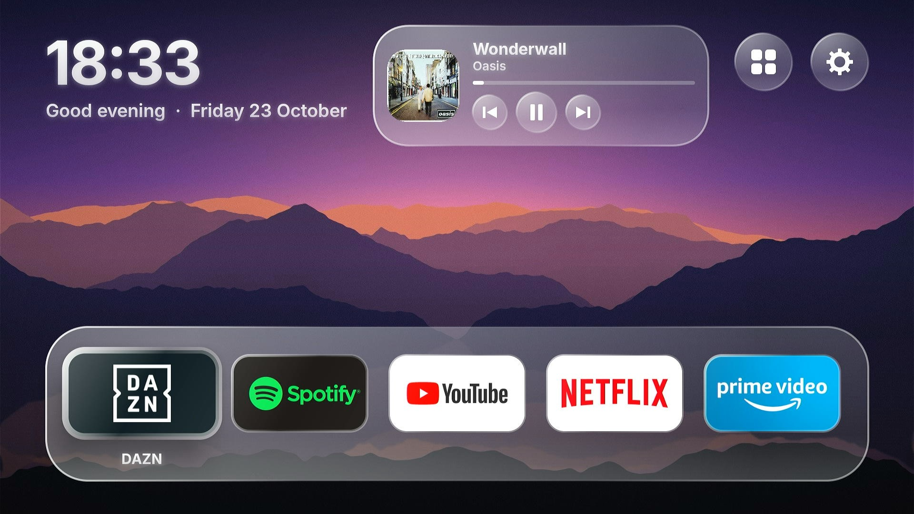
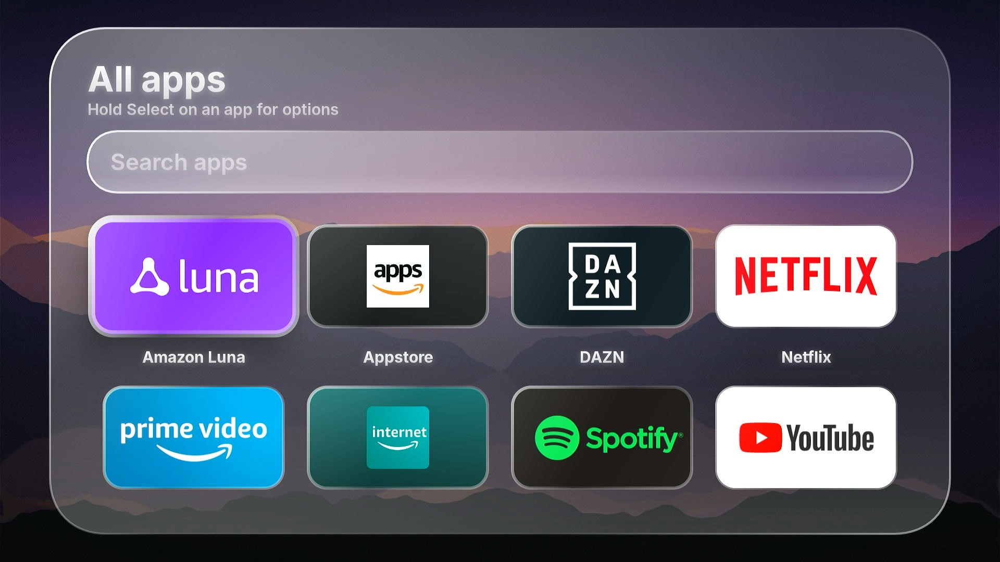
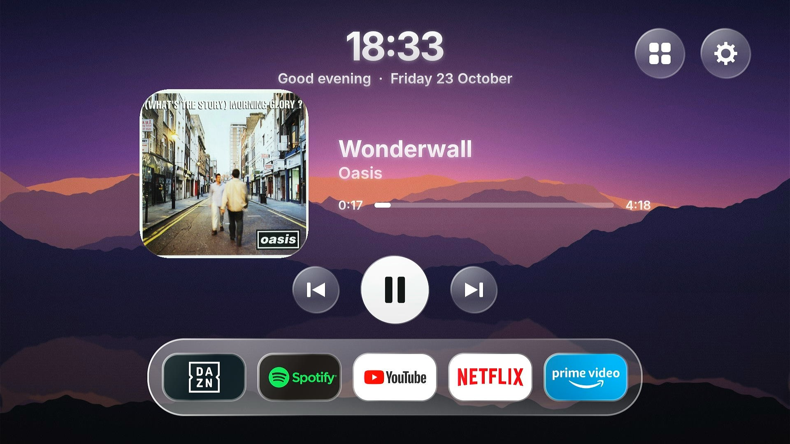
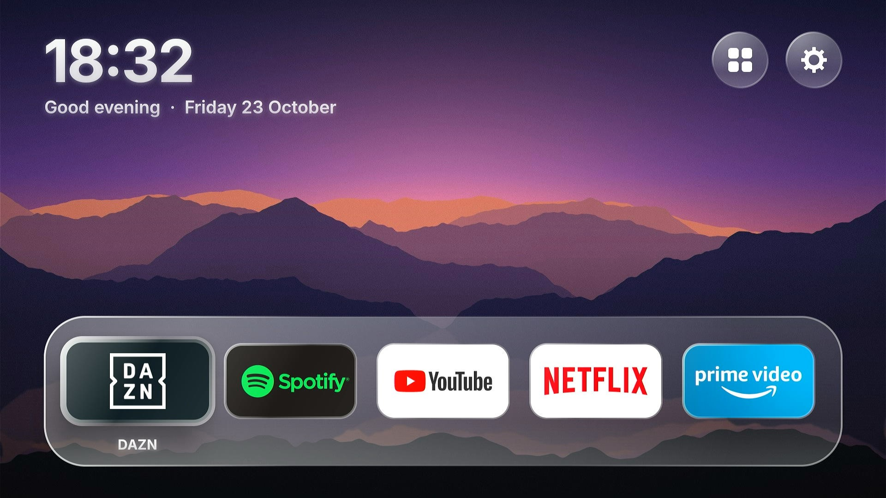

# ChipOS

A fast, minimal, tvOS-inspired home screen (launcher) for Amazon Fire TV sticks.

Fire OS's stock home screen is slow on older sticks and full of promotions. ChipOS replaces it with
a clean dock of your favourite apps over slowly rotating wallpapers, plus a music player, weather,
a custom settings screen and an ambient clock. It is a launcher *app*, not an operating system:
Fire OS stays underneath, and everything ChipOS does is reversible.

> **Status: alpha.** Developed and used on one 3rd-generation Fire TV Stick (Fire OS 7.7.1.2).
> Expect rough edges. Please open issues. See [Known limitations](#known-limitations), especially
> the one about the Home button.

<p align="center">
  
  
</p>
<p align="center">
  
  
</p>

## Read this first: the Home button

Fire OS **always** opens Amazon's launcher when you press Home, and on current Fire OS 7 versions it
cannot be disabled, hidden, removed or replaced as the default without root. (`pm disable-user`,
`pm hide`, `pm uninstall` and `set-home-activity` were all tried; Fire OS refuses or ignores them.)
The only known root exploit works on Fire OS older than 7.2.7.3 and is patched in newer versions.

What ChipOS does instead: an optional Accessibility service notices when Amazon's home screen
opens and opens ChipOS. Android blocks apps from opening screens for about **5 seconds** after Home
is pressed, so you see Amazon's screen briefly before ChipOS appears. ChipOS cannot avoid that
delay. If you can live with it, ChipOS behaves like your home screen. If not, simply open ChipOS
from the app list when you want it.

## Features

- **Dock** of up to 7 apps (defaults: DAZN, Spotify, YouTube, Netflix, Prime Video, ESPN; apps that
  are not installed are hidden). Add, remove and reorder by holding Select on any app.
- **All apps** grid with search, and **hide apps** you never use.
- **Recent apps** row above the dock.
- **Music player** for Spotify and other audio apps: cover art, progress, previous/play/next,
  and a full-size player when you press the cover.
- **Weather** next to the clock (type a city once).
- **Ambient screen:** after a chosen idle time, only the wallpaper and one big clock.
- **Own wallpapers:** use your photos instead of, or as well as, the bundled ones.
- **Settings screen** replacing most of Fire OS Settings: Wi-Fi, Bluetooth, Sound, Apps (uninstall),
  About, animation speed, and Home screen options. Things only Fire OS can change (display modes,
  updates, factory reset, accounts) open the matching Fire OS page.
- **Free memory** button that closes background apps (not ones playing music).
- Frosted "liquid glass" look, D-pad friendly focus, bundled Inter font, no ads, no analytics.
- Light on memory: one wallpaper decoded at screen size, icons loaded on demand, timers paused
  while another app is in front.

## Requirements

- A Fire TV stick running Fire OS 7 (Android 9, API 28). Developed on the 3rd generation Fire TV
  Stick. Fire OS 5/6 sticks and Android 10+ devices are not supported (the Wi-Fi and Bluetooth
  settings pages use Android 9 APIs that newer Android versions removed).
- A computer on the same Wi-Fi network to install the app.
- [Android Studio](https://developer.android.com/studio) or just a JDK 17+ to build, and
  [`adb`](https://developer.android.com/tools/releases/platform-tools).

## Build

1. Open the project in Android Studio and let Gradle sync (accept the install of
   **Android SDK Platform 34**), or build from a terminal.
2. Build the **release** variant (much faster than debug, because Compose is slow in debug):
   - Windows PowerShell: `.\gradlew.bat assembleRelease`
   - macOS/Linux: `./gradlew assembleRelease`
3. The APK is at `app/build/outputs/apk/release/app-release.apk`. It is signed with the debug key so
   it installs directly. This project is for sideloading, not the Play Store.

Pre-built APKs are attached to GitHub Releases when a version is tagged.

If Gradle complains about the Java version, use JDK 17 or 21 (JDK 25 is too new for this Gradle
version). In PowerShell: `$env:JAVA_HOME = "C:\path\to\jdk-21"`.

## Install on your Fire TV

On the Fire TV: **Settings > My Fire TV > About**, click the device name 7 times, then
**Developer Options > ADB debugging: On**. Note the IP address under About > Network.

```
adb connect <FIRE-TV-IP>:5555
scripts\install.bat
```

`install.bat` installs the APK, grants two optional permissions (location, so Wi-Fi and Bluetooth
scans return results, and secure settings, for the animation speed option; ChipOS never reads your
location), enables the music listener and starts ChipOS. To update later:
`adb install -r app\build\outputs\apk\release\app-release.apk`.

ChipOS now appears in your app list. Amazon's launcher is **still** the default, so nothing is lost
if you do not like it.

### Open ChipOS when you press Home (optional)

```
scripts\enable-home-button.bat
```

This turns on the Accessibility service described [above](#read-this-first-the-home-button). It
only sees which app's window opened, never your screen. Undo with `scripts\disable-home-button.bat`.
You may need to run it again after reinstalling ChipOS. ChipOS also tries to open itself when the
stick finishes booting; Fire OS may or may not allow that on your version.

To uninstall completely: `adb uninstall app.chipos.launcher`.

## Using it

- **Hold Select** (or press the remote's **menu** button) on any app: open, app info, hide from All
  apps, add/remove/move in the dock, uninstall (for apps you installed).
- **All apps:** press Up from the first row to reach the search box, press Select to type.
- **Music player:** needs a notification listener, which `install.bat` enables (or run
  `scripts\enable-now-playing.bat`). ChipOS never reads notifications; it only reads media sessions.
  Video apps such as Netflix are ignored on purpose. Spotify keeps playing in the background by itself;
  `scripts\keep-spotify-alive.bat` removes Android's background limits for it, but Fire OS can still
  close apps when the stick runs low on memory.
- **Weather:** Settings > Weather, type a city. Data comes from [Open-Meteo](https://open-meteo.com).
- **Ambient screen:** Settings > Ambient screen after (2, 5, 10, 30 minutes, or off). Any button wakes it.
- **Own wallpapers:** drag a folder of photos onto `scripts\push-wallpapers.bat`, then
  Settings > Wallpapers > My photos or Both.
- **Free memory:** Settings > Free memory. How much it frees depends on what is running.

## Customise

| What | Where |
| --- | --- |
| Default dock apps | `app/src/main/java/app/chipos/launcher/data/DockConfig.kt` (package names; find them with `adb shell pm list packages`) |
| Bundled wallpapers | JPG/PNG/WebP files (ideally 1920x1080) in `app/src/main/assets/wallpapers/` |
| Regenerate bundled wallpapers | `python tools/generate_wallpapers.py` |
| Regenerate icon and banner | `python tools/generate_icons.py` |

The bundled wallpapers are generated procedurally by `tools/generate_wallpapers.py`, so they carry
no third-party copyright. They are stylised landscapes, not photographs.

## Project layout

```
app/src/main/java/app/chipos/launcher/
  MainActivity.kt          Home activity: keys, Back handling, lifecycle
  HomeKeyService.kt        Optional Accessibility service (opens ChipOS when Amazon's home appears)
  BootReceiver.kt          Opens ChipOS after boot
  NowPlayingListener.kt    Notification listener that grants access to media sessions
  data/                    Dock, hidden/recent apps, prefs, weather, wallpapers, now playing, system actions
  ui/                      Compose UI: home, dock, All apps, settings pages, player, ambient screen
app/src/main/assets/wallpapers/   Bundled wallpapers
scripts/                   Windows helpers (install, permissions, Home button, wallpapers, Spotify)
tools/                     Python generators for wallpapers and icons
.github/workflows/         CI: build on push, attach an APK to tagged releases
```

Stack: Kotlin, Jetpack Compose (foundation only, no Material), AGP 8.5, minSdk 28.

## Privacy and permissions

No accounts, no analytics, no ads. The only network request ChipOS makes is the weather lookup, if
you turn weather on: it sends the city name you typed (and then its coordinates) to Open-Meteo.

Permissions it declares: Wi-Fi and network state, location (needed by Android for Wi-Fi and
Bluetooth scan results), Bluetooth, delete packages (uninstall dialogs), kill background
processes (Free memory), internet (weather), boot completed, and the optional notification listener
and Accessibility service described above.

## Known limitations

- **Home button:** see [the top of this page](#read-this-first-the-home-button). Amazon's launcher
  cannot be removed without root, and there is a delay of about 5 seconds.
- **Fire OS updates** may switch the Accessibility service off. Run `scripts\enable-home-button.bat` again.
- **Less tested:** opening at boot, the own-wallpapers folder, and the Free memory button.
- **Voice (Alexa) and recommendations** are not part of ChipOS.
- **Resolution:** Fire TV sticks output 16:9 modes only. On an ultrawide monitor the picture is
  letterboxed or stretched by the monitor's own scaling; ChipOS cannot change that.
- Tile artwork comes from each app's banner or icon, so quality varies. Icon-only tiles get a
  background tinted from the icon's colors.
- Windows-only helper scripts (`.bat`); on macOS/Linux run the `adb` commands inside them by hand.

## Roadmap

- Signed release builds and an in-app update check
- Make the Home-button delay shorter if a way is found that does not need root

## Credits and disclaimer

Weather data by [Open-Meteo.com](https://open-meteo.com) (CC BY 4.0). The Inter typeface is bundled
under the SIL Open Font License (see [THIRD_PARTY_NOTICES.md](THIRD_PARTY_NOTICES.md)).

ChipOS is an independent hobby project. It is not affiliated with or endorsed by Amazon, Apple, or any
streaming service whose app can be placed in the dock. All product names and trademarks belong to
their owners. The design is inspired by the general look of a TV home screen; no third-party artwork
or icons are included.

## License

[MIT](LICENSE)
